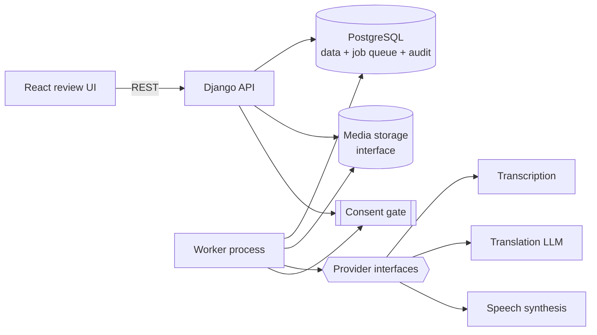

# HyperLocalize — Phase 0 Discovery Report

| | |
|---|---|
| **Date** | 2026-10-04 |
| **Phase** | 0 — Discovery and Design |
| **Status** | DRAFT, revision 2, awaiting review. Nothing in this document is approved. |
| **Revision 2** | Applies review points R1–R5: consent checks at each stage boundary and mid-job cancellation (§6.8), audit threat model (§6.10), rule-based checks vs. AI flags (§4.3), novelty reclassification (§9), and spike before the provider ADRs (§10). Adds the ADR grouping (§12). Answers to Q1–Q8 **were not received** (the template placeholders came back unfilled), so the ADRs that depend on them are marked blocked. |
| **Sources read** | `CLAUDE.md`, `docs/context/01`–`05`, `docs/STATUS.md` |
| **Sources missing** | UML diagrams, official requirements, official problem statement. Under `04_source_of_truth_policy.md` these outrank this report. See Question Q1. |

### How to read this report

- **Status labels**: [CONFIRMED] = stated in project sources. [PROPOSED] = my recommendation, not yet approved. [INFERRED] = my interpretation of confirmed material. [UNKNOWN] = not established.
- **External tools and models.** Statements about third-party tools (licences, capabilities, maintenance status) come from my training knowledge. I did **not** verify them in this session. Each one must be re-checked before it goes into an ADR. Where I'm unsure, I say so.
- **No numbers are measured.** Every number below is a TARGET or a placeholder. There are no MEASURED RESULTS yet, because no code exists.
- **No application code was written.**

---

## 0. Executive summary

1. **Strategic recommendation.** HyperLocalize should not compete with commercial dubbing tools on raw dubbing quality, because a student team will lose that contest. It should compete on **trustworthy localization of critical information in high-stakes domains**. The differentiator is a *combination* of three things: (a) **critical-information verification**, meaning rule-based checks for numbers, units and glossary terms plus AI flags for possible meaning reversal, (b) a **mandatory human review gate**, and (c) an **export that carries its own evidence**. Consent that the backend enforces and that cascades on revocation is a required safeguard, classified as [ENHANCEMENT] (§9). No single part is claimed to be new. These properties are defensible in a viva and can be measured. [PROPOSED]
2. **Reframe "identity-preserving" as "consent-governed identity preservation".** A speaker's voice is reproduced only when, and only as far as, a current consent record allows. When consent is missing or revoked, the system falls back automatically to a non-identity voice or to subtitles. This turns the riskiest part of the concept into its strongest argument. [PROPOSED]
3. **Define "context-aware" so it can be tested.** Context means a fixed set of inputs (transcript window, speaker, audience profile, glossary, timing budget) passed to a replaceable LLM stage. An **ablation study** (context on vs. context off vs. a plain machine-translation baseline) then shows whether the context actually helps. [PROPOSED]
4. **MVP:** one short video, one language pair, at most two consenting speakers (team members), voice dubbing plus subtitles, scene-level regeneration, approval, an export with an evidence manifest, and a live demonstration of consent revocation. **Out of scope:** lip-sync, face manipulation, and on-screen text replacement. [PROPOSED]
5. **Stack:** a Python modular monolith (Django + Django REST Framework), PostgreSQL, a Postgres-backed job queue (no Redis or Celery at first), local file storage behind an interface, a React + TypeScript review UI, and AI providers behind interfaces with clearly named mocks. Everything runs under Docker Compose. [PROPOSED]
6. **Blocking unknowns.** The official UML and requirements, team size and deadline, the language pair, budget and GPU access, and whether evaluators expect lip-sync. See §11.
7. **Sequencing.** The ADRs that don't depend on AI quality (group A, §12) can be approved now. The AI-provider, translation-method and identity-feasibility ADRs (group B1) are decided only **after** the technical spike (`docs/SPIKE_PLAN.md`) has produced measured results. Framework, frontend, auth and hosting (group B2) wait for your answers to the open questions.

---

## 1. Restated problem and scope check

**Requirement (Phase 0, CLAUDE.md §9):** resolve seven design questions before any application code is written. [CONFIRMED]

**Actors served:** all six. Phase 0 shapes every use case. [CONFIRMED]

**What the sources do and do not establish:**

| Topic | Status | Note |
|---|---|---|
| Core workflow (8 steps) | [CONFIRMED] | `01_project_master_context.md` |
| 6 actors, 9 use cases | [CONFIRMED] | `02_actors_and_use_cases.md` |
| Technical meaning of "identity" | [UNKNOWN] | CLAUDE.md §5 says this explicitly |
| Technical meaning of "context-aware" | [UNKNOWN] | Only the inputs are listed as candidates |
| Tech stack, models, providers | [UNKNOWN] | |
| Data model / UML | [UNKNOWN] | CLAUDE.md says "aligned with the UML", but no UML is in the repo |
| Language pairs, video lengths, team size, deadline, budget | [UNKNOWN] | |
| Meaning of "Evidence", "Quality", "Policies" | [UNKNOWN] | Named as concepts, never defined |

---

## 2. Challenges to the current concept

These are the points I expect a technical examiner to attack. Each has a proposed fix.

| # | Weakness | Why it is hard to defend | Proposed alternative |
|---|---|---|---|
| C1 | **"Identity-preserving" is undefined and ethically loaded.** | Reproducing a real person's voice or face is the same technology used for deepfakes. If the project can't say exactly what it preserves, under what consent, and what happens on revocation, an examiner will frame it as a deepfake tool with a consent checkbox. | Reframe as **consent-governed identity preservation** (§3). Identity rendering becomes a per-speaker *mode* (cloned voice → stock voice → subtitles only) chosen by the backend from the current consent state. |
| C2 | **"Context-aware" is a buzzword unless it can be falsified.** | Every LLM translation is "context-aware" in some sense. Examiners will ask what context, how it is used, and how you know it helps. | Fixed, enumerated context inputs plus an ablation evaluation against a context-free baseline (§4, §8). If the ablation shows no benefit, report that honestly. |
| C3 | **"Isn't this just a wrapper around an LLM and a voice API?"** | Most of the pipeline (ASR → MT → TTS) is commodity technology. | Make the contribution explicit: (a) the governance layer (consent gate, revocation cascade, audit, evidence manifest), (b) a **verification layer**, with rule-based hard checks for numbers, units and glossary terms and AI flags for meaning reversal that a reviewer must look at, and (c) measured evaluation. The AI stages are swappable components, not the product. |
| C4 | **Use cases 3 and 4 overlap in name.** "Generate Context-Aware Localization Preview" and "Generate Localized Preview" sound like the same thing. | An examiner will ask what the difference is. | [PROPOSED] **UC3 = script-level localization** (the translated and adapted script with rationale and flags, reviewed as text). **UC4 = media rendering** (synthesised audio, subtitles, preview video). This also gives two review points: cheap text review before expensive rendering. Needs confirmation (Q11). |
| C5 | **UC1 "Create *and Generate* a Localization Project"** packs the whole pipeline into the first use case. | It duplicates UC2–UC4 and blurs boundaries in the UML. | [PROPOSED] UC1 = create and configure the project (languages, audience profile, glossary, speakers, reviewers). Generation belongs to UC2–UC4. If the UML deliberately treats UC1 as an "orchestrate everything" use case, keep it and show «include» relationships to UC2–UC4. |
| C6 | **"Scene" is ambiguous.** It could mean a shot (visual cut), an utterance (speech), or a semantic scene. | Regeneration granularity, the data model, and the UI all depend on this. | [PROPOSED] **Segment** = one speech utterance (the unit of translation and text editing). **Scene** = a contiguous time range that groups segments, with boundaries taken from shot cuts merged with speech pauses (the unit of rendering, review, and regeneration). |
| C7 | **"Preserving intended meaning" has no metric.** | It can't be claimed without one. | Use a recognised translation-error framework (MQM-style categories: accuracy, fluency, terminology, style, locale) for human review, plus automatic metrics as supporting evidence (§8). |
| C8 | **Health, food, water, and energy are high-stakes domains.** A mistranslated dosage or water-treatment instruction causes harm. | Claiming social impact without safety mechanisms invites the obvious objection. | Turn this into a strength. Add **rule-based hard checks** (numbers, dosages, units, glossary terms) and **AI-flagged checks** for negation and meaning reversal. Flagged segments go to mandatory human review and are never described as "verified" (§4.3). Require human review for every export. Never describe the output as authoritative domain advice. Keep the positioning "information access" (as CLAUDE.md already does). |
| C9 | **Revoking consent cannot recall files that have already left the system.** | A claim that revocation "removes" a person's identity everywhere would be false. | Define revocation honestly (§3.4). Block, cancel, and quarantine everything inside the system. Mark exports revoked and block downloads. Delete provider-side voice profiles. State plainly that copies already downloaded cannot be recalled. |
| C10 | **"Auditor / Faculty Evaluator" mixes a product role with an academic one.** | Product roles should be meaningful for real deployments. | Model the role as **Auditor** (read-only access to audit, quality, and evidence). "Faculty Evaluator" becomes a demo account that holds the Auditor role. |
| C11 | **"Evidence", "Quality", and "Policies" are undefined.** | Undefined nouns become vague UI screens. | [PROPOSED] **Evidence** = the audit chain plus the export evidence manifest (§7.4). **Quality** = per-scene validator flags, review outcomes, and evaluation metrics. **Policies** = admin-configurable rules such as allowed providers, whether voice cloning is permitted at all, required reviewer count, and retention periods. |
| C12 | **Lip-sync and face re-animation** are tempting demo features. | They need a GPU, the leading open models often carry non-commercial licences (verify), the quality is uneven, and they sharply increase deepfake risk. Implemented badly, they hurt the demo. | Keep them out of the MVP. If evaluators expect them (Q5), treat them as a separate stretch ADR with its own consent scope. |
| C13 | **Dubbed speech often doesn't fit the original timing**, because the translated text is longer or shorter. Commercial tools call this isochrony. | This is the most visible quality defect in a dubbing demo, and it is often ignored in student projects. | Treat the time budget as a first-class constraint. Ask the translator for length-constrained output, allow bounded speed adjustment in TTS, and flag segments that still overflow so the reviewer can decide. Measure the result as "timing fit" (§8). |

---

## 3. Item 1: what "identity-preserving" means

### 3.1 Problem and constraints

- "Identity" is [UNKNOWN] (CLAUDE.md §5). It must not assume voice cloning, face swapping, biometrics, watermarking, or signing until an ADR establishes them. [CONFIRMED]
- Consent must be enforced in the backend, revocation must actually stop processing, and everything must be audited. [CONFIRMED]
- Voices and faces are sensitive personal data. A voice embedding or clone is arguably biometric data in many legal regimes. I am not giving legal advice here, and nothing in this report claims compliance.

### 3.2 Options

| Criterion | **A. Consent records only** (identity = attribution metadata; synthesis uses generic voices) | **B. Voice identity, consent-gated with fallback** (cloned voice only under active consent; else stock voice or subtitles) | **C. Voice + face (lip-sync / re-animation)** | **D. No synthesis** (subtitles only; identity = speaker attribution) |
|---|---|---|---|---|
| Matches the "identity-preserving" claim | Weak: nothing about the person is preserved | **Strong for voice** | Strongest | None |
| Output quality | Natural voice, but not the speaker's | Depends on provider and language; must be measured | Variable; artefacts are common | Very high (text only) |
| Ethical risk | Low | Medium, mitigated by the consent gate | **High** (deepfake-equivalent) | Very low |
| Consent complexity | Low | Medium: needs scopes, versions, revocation, provider deletion | High: separate face and voice scopes | Minimal |
| Compute and cost | Low | Medium (hosted API) or GPU (local) | High; GPU needed | Very low |
| Implementation difficulty | Low | Medium | High | Low |
| Viva defensibility | "So where is the identity?" | **Clear story**: the identity owner controls how they are rendered | Hard: licensing, misuse, quality | Contradicts the project name |

### 3.3 Recommendation [PROPOSED]

**Option B: consent-governed voice identity with automatic fallback.**

"Identity" will mean three things:

1. an **Identity Owner** record (a real person),
2. a **Voice Profile** derived from their consented reference audio, and
3. a **versioned Consent** record that lists the permitted *uses* (e.g. `voice_synthesis`), projects, target languages, and expiry.

Each Speaker in a video gets a **rendering mode** that the backend resolves at the moment of rendering:

| Consent state for the speaker | Resolved rendering mode |
|---|---|
| Active consent covering `voice_synthesis` for this project and language | `CLONED_VOICE` |
| No consent, expired, or revoked | `STOCK_VOICE` (a neutral synthetic voice, labelled as such) |
| Policy forbids synthesis for this project | `SUBTITLES_ONLY` |

Faces are **not processed** in the MVP. The video track is passed through unchanged.

**Weaknesses of this recommendation:**
- Voice cloning quality varies a lot by target language. For low-resource languages it may sound worse than a good stock voice. A spike is needed before committing to a provider (Q3, Q4).
- A hosted cloning provider stores the voice on its side. Revocation therefore depends on the provider's deletion API, and on trusting that the deletion is real. Local models avoid this but need a GPU and are often restricted to non-commercial use (verify each licence).
- Speaker similarity is hard to evaluate rigorously with a small team (§8).
- Mixing a cloned voice for one speaker with a stock voice for another can be jarring. This is acceptable because it is honest, and the UI must make it visible.
- Without lip-sync, dubbed video looks visibly dubbed. That is an acceptable, explicit trade-off.

### 3.4 Revocation behaviour (Revoke Consent and Stop Identity, UC7) [PROPOSED]

All of the following happen in one database transaction where possible. External calls are retried asynchronously.

| What exists at revocation time | Behaviour |
|---|---|
| New generation requests using the identity | **Blocked** by the backend consent gate. The request returns a clear error. |
| Queued jobs using the identity | **Cancelled** in the same transaction as the revocation. |
| Running jobs | Flagged `cancel_requested`. The worker re-checks consent at every stage boundary (CP1–CP10, §6.8) and stops at the next one. The job ends `CANCELLED` (reason `CONSENT_REVOKED`) and is never retried. A provider call already in flight cannot be interrupted, but its result is thrown away. Segments persisted earlier in the same job are quarantined by the cascade. |
| Previews rendered with the identity | Marked `CONSENT_REVOKED`, no longer playable, media deleted after a short quarantine (retention policy, Q15). Affected scenes return to "needs regeneration" and re-render with the fallback mode, which requires review again. |
| Approvals that depend on those previews | **Invalidated.** A new approval is required. |
| Exports already produced | Marked `CONSENT_REVOKED`, downloads blocked, Localization Manager notified. **Copies already downloaded cannot be recalled.** This limitation is documented in the UI and in this report. |
| Provider-side voice profile | Deleted through the provider API. Success or failure is audited, and failures are retried and surfaced to the Administrator. |
| Reference audio samples | Deleted (or quarantined, then deleted, per retention policy). |
| Source video | **Not** deleted by voice-consent revocation, because the original recording is the organisation's content. Open question Q15. |
| Audit records | **Kept**, because they are the evidence. They hold identifiers and consent versions, never raw audio. |

### 3.5 Disclosure [PROPOSED]

Every export that contains synthetic speech carries a machine-readable "synthetic speech" disclosure in its manifest and an optional on-screen or spoken notice. Audio watermarking and cryptographic signing remain [UNKNOWN] and would each need their own ADR. Regulations on synthetic-media disclosure exist in some jurisdictions (for example, the transparency obligations in the EU AI Act). I have not verified how they apply to this project, so this report makes no compliance claim.

---

## 4. Item 2: what "context-aware" means

### 4.1 Candidate context inputs

| Input | What it resolves | Source | MVP? |
|---|---|---|---|
| Transcript window (previous and next N segments) | Pronouns, ellipsis, terminology consistency | ASR output | Yes |
| Speaker identity and role | Register (doctor vs. patient), gendered grammar in the target language | Diarisation + human assignment | Yes |
| **Audience profile** (target locale, formality, reading level, domain, cultural notes) | Register, idiom adaptation, units, examples | Set by the Localization Manager in UC1 | Yes |
| **Glossary / do-not-translate list** | Domain terminology, brand names, drug names | Set by the manager or reviewer | Yes |
| **Timing budget** (segment slot duration) | Length-constrained translation (isochrony) | Segment timestamps | Yes |
| Visual context (keyframe captions) | Deictic references ("this bottle", "press here") | Vision-language model on keyframes | Stretch |
| On-screen text (OCR) | Text in the video that is spoken about or needs subtitles | OCR or a vision-language model | Stretch |

### 4.2 Method options

| Criterion | **A. Segment-by-segment MT** (e.g. a DeepL/Google-style NMT API, or open NMT) | **B. LLM with structured textual context** (inputs 1–5; structured output with rationale) | **C. B + visual context** (keyframe captions and OCR added) | **D. Fine-tuned or custom model** |
|---|---|---|---|---|
| Quality on idioms, register, audience | Low–medium; literal | Medium–high (to be measured) | Potentially higher for visual references (unproven) | Unknown; needs data the team doesn't have |
| Explainability to the reviewer | None | **Per-segment rationale and adaptation type** | Same, plus visual grounding | Low |
| Determinism and reproducibility | High | Lower; mitigated by pinning model, prompt version, temperature, and logging | Lower | Medium |
| Cost and latency | Low | Medium (must be measured) | Higher (vision calls) | High setup cost |
| Failure mode | Fluent but wrong in context | Hallucinated additions or omissions → caught by validators and review | Same, plus caption errors | Unknown |
| Implementation difficulty | Low | Medium | Medium–high | Very high |
| Viva defensibility | Not context-aware | **Clear, if backed by the ablation** | Good only if the ablation shows gain | Unrealistic for the team |

### 4.3 Recommendation [PROPOSED]

**Option B for the MVP, with Option A kept as an evaluation baseline. Option C becomes a stretch goal, justified only if an ablation shows it helps.**

The design has three layers: **AI drafts → rules verify → humans decide.**

1. **Draft.** The LLM returns structured output for each segment: `translation`, `adaptation_type` (literal / adapted / localised / kept-original), `rationale` (a short note for the reviewer), `uncertainty_flags`, and an estimated spoken duration. The prompt template is versioned and stored with every output.
2. **Verify.** There are two kinds of check, and the difference matters:

   | Kind | Checks | How | Effect | What we may claim |
   |---|---|---|---|---|
   | **Hard rule-based checks** (deterministic, non-AI) | Numbers (after normalising digits, native-script numerals and decimal separators), units (per-language unit lexicon plus any conversions declared in the audience profile), glossary and do-not-translate terms, empty or untranslated output, length vs. timing budget | Plain code with unit tests | A failure **blocks approval** until it is fixed, or overridden by a reviewer with a written reason (audited) | "Rule-verified for numbers, units and glossary terms", within the limits below |
   | **AI-flagged checks** (advisory) | Negation, meaning reversal, omissions and additions, register mismatch | A second LLM pass compares source and draft and returns flags with a short explanation | Flagged segments need **explicit reviewer acknowledgement** before approval | Only "flagged for human review". **Never "verified".** |

   *Why negation is not rule-checked:* in many target languages, negation is part of the grammar rather than a separate word. It can be a verb suffix, a mood, or an auxiliary, and it may be spread across a clause. A token rule like "source contains *not*, so target must contain X" would give many false alarms and miss real errors. AI flags can also miss reversals, so **every** segment still goes through human review, not only the flagged ones.

   *Known limits of the hard checks:* numbers written as words need a per-language number-word normaliser, which may only partly cover the target language. Glossary terms can appear inflected in agglutinative languages, so matching uses stems or allows suffixes, which can cause false results either way. Both limits are why a reviewer can override a check (with an audited reason).
   
   This is where "AI output is a draft" becomes concrete.
3. **Decide.** The reviewer sees the source, the draft, the rationale, and the flags side by side, then edits, accepts, or requests regeneration with an instruction.

**Answers to the CLAUDE.md §4 questions:**
- *Non-AI alternative:* plain NMT. It can't take an audience profile, register, or reviewer instructions, and it gives no rationale. Its weaknesses will be **measured**, not assumed, because it doubles as the baseline.
- *When the AI is wrong:* validators catch mechanical errors, and reviewers catch semantic ones. Every segment can be edited and regenerated. Nothing is exported without approval.
- *Evaluation:* MQM-style human error annotation plus automatic metrics, as an ablation (§8).
- *Cost and latency per video minute:* **not yet measured.** To be measured in the spike (§10).

**Weaknesses:**
- LLM translation quality for low-resource target languages may be weak. The choice of language pair (Q3) can make or break this.
- Output varies between runs. Reproducibility depends on logging the model version and prompt version, not on regenerating the same text.
- A rationale written by the LLM is a **post-hoc explanation**, not a faithful account of how the text was produced. The UI and the viva must describe it as "the model's stated reason", and claim nothing more.
- Data leaves the machine if a hosted LLM is used (Q6).

---

## 5. Item 3: demo-scope MVP

### 5.1 Options

| Criterion | **A. Subtitles only** | **B. Dubbing with stock voices** | **C. Dubbing with consent-governed voice identity + fallback + revocation demo** | **D. C + lip-sync** |
|---|---|---|---|---|
| Proves the core workflow | Yes | Yes | **Yes** | Yes |
| Proves "identity-preserving" | No | No | **Yes** | Yes |
| Proves consent enforcement | Weakly | Weakly | **Yes (live revocation)** | Yes |
| Risk of not finishing | Low | Low–medium | Medium | High |
| Demo impact | Low | Medium | **High** | High, if it works |

### 5.2 Recommendation: Option C, built as vertical slices [PROPOSED]

**Demo scope:** one source video of 1–3 minutes (TARGET), recorded by the team, on a critical-information topic (e.g. a health-information explainer); **one** language pair; at most two speakers, all team members who have signed consent; and one target audience profile.

**Thin slices, in build order.** Each slice is a working path from start to finish.

| Slice | Delivers | Use cases | Identity used? |
|---|---|---|---|
| **S1** | Project → upload and validate → ASR → segments/scenes → context-aware translation + validators → script review → approve → export (subtitles + script + manifest). Audit records throughout. | UC1, UC2, UC3, UC6 (partial), UC9 (partial) | No |
| **S2** | Stock-voice TTS per segment → timing fit → mix over ducked original audio → preview video → scene-level review and **regeneration** | UC4, UC5 | No |
| **S3** | Identity Owner, Consent (versioned), Voice Profile, **consent gate**, cloned-voice rendering, **revocation cascade + fallback** | UC7, UC4 | **Yes** |
| **S4** | Evaluation harness: ablation runs, metric scripts, seeded-error review test, audit-chain verifier | UC9 | — |
| **S5** (stretch) | Visual context via keyframe captions/OCR, background-music separation, a second language pair | UC3, UC4 | — |

UC8 (Administer Users, Providers and Policies) is covered across the slices, initially by the framework's admin interface plus a small set of policy settings.

**Explicitly out of the MVP:** lip-sync, any face processing, replacing on-screen text, real-time processing, multiple target languages per run, public-figure or third-party voices, and mobile apps.

**Weaknesses:** S3, the most differentiating slice, comes third, so a schedule slip hits it first. Mitigation: S3's data model and consent gate are designed now, and S2 is kept deliberately minimal. Building identity first was rejected because without S1/S2 there is nothing to render the identity into.

---

## 6. Item 4: tech stack and architecture (ADR proposals)

Each table below is a proposed ADR. None of these ADRs is written yet, because they need your approval first.

### 6.1 ADR-P1: Architecture style → **ADR 0001**

| Criterion | **Modular monolith** (one deployable app, domain modules, separate worker process) | Microservices | Serverless functions |
|---|---|---|---|
| Simplicity and explainability | **High** | Low | Medium |
| Consent and audit consistency | **Single DB transaction** | Distributed consistency problem | Hard |
| Scalability | Enough for the demo; workers scale horizontally | High | High |
| Ops burden | Low | High | Medium; vendor lock-in |
| Viva | **"Clear modules, one transaction boundary"** | Over-engineering for this scale | Hard to explain long video jobs |

**Recommendation:** modular monolith with a separate worker process. **Weakness:** a single DB is a bottleneck at scale, and module boundaries must be enforced by discipline rather than by the network.

Proposed modules [PROPOSED], named after the domain:

```
accounts      users, roles, project memberships
projects      Project, AudienceProfile, GlossaryTerm
media         upload, validation (ffprobe), storage interface
analysis      transcription, speaker tracks, segmentation into scenes
localization  translation drafts, validators, flags
rendering     speech synthesis, timing fit, mixing, subtitles, preview
review        reviews, regeneration requests, approvals
identity      IdentityOwner, Consent, VoiceProfile, consent gate
exports       export packages, evidence manifest
audit         AuditRecord, chain verification
providers     provider interfaces, real adapters, Mock* adapters
jobs          job table, worker loop, state machine
```



### 6.2 ADR-P2: Backend language and framework → *group B2, blocked on Q2/Q9*

| Criterion | **Python + Django + DRF** | Python + FastAPI | Node.js + NestJS |
|---|---|---|---|
| ML and media ecosystem (ASR, audio, ffmpeg wrappers) | **Native** | **Native** | Weaker; would need Python sidecars |
| Auth, permissions, ORM, migrations, admin built in | **Yes** (admin largely covers UC8) | No; assemble yourself | Partly |
| Async API performance | Adequate (long work goes to workers anyway) | High | High |
| Amount of non-differentiating work | **Low** | Higher | Medium |
| Readability for a CSE viva | Good; conventions are well documented | Good | Good |

**Recommendation:** Django + Django REST Framework. Admin, auth, ORM, and migrations are not where this project's value lies, so take them off the shelf. **Weaknesses:** Django's "magic" (signals, ORM laziness) can hide behaviour, so avoid signals for audit and consent and use explicit service functions instead. Django is sync-first, which is acceptable because the API never waits on long work. If the team already knows FastAPI well, that is a legitimate alternative (Q9).

### 6.3 ADR-P3: Frontend → *group B2, blocked on Q2/Q9*

| Criterion | **React + TypeScript (Vite)** | Django templates + HTMX | Streamlit/Gradio |
|---|---|---|---|
| Review workspace (video player synced to segment list, inline edit, flags) | **Strong** | Possible but awkward | Poor; not a real multi-user app |
| Separate codebase | Yes | No | No |
| Learning curve | Medium | Low | Very low |
| Credibility as a product | **High** | Medium | Low ("a notebook demo") |

**Recommendation:** React + TypeScript. **Weakness:** two codebases, plus the work of handling CSRF and session auth across them. If no one on the team knows React, HTMX is the fallback (Q9).

### 6.4 ADR-P4: Database → **ADR 0002**

| Criterion | **PostgreSQL** | SQLite | MongoDB |
|---|---|---|---|
| Relational integrity (consent → job → preview → export) | **Yes** | Yes | Weak |
| Concurrency, job queue (`SELECT … FOR UPDATE SKIP LOCKED`) | **Yes** | No (single writer) | Different model |
| JSON for provider outputs | JSONB | JSON1 | Native |
| Ops | Needs a server (Docker) | None | Needs a server |

**Recommendation:** PostgreSQL. Tests run against Postgres too, not SQLite, so that locking and constraint behaviour is actually tested. **Weakness:** one more container, and the team must learn migrations and basic locking.

### 6.5 ADR-P5: Job / pipeline architecture → **ADR 0003**

| Criterion | In-process background tasks | **Postgres-backed job queue + worker process** | Celery + Redis | Workflow engine (e.g. Temporal) |
|---|---|---|---|---|
| Survives restart | No | **Yes** | Yes | Yes |
| Consent check and job claim in **one transaction** | No | **Yes** | No (two systems) | No |
| Extra infrastructure | None | **None** | Redis/RabbitMQ | Heavy |
| Throughput | Low | Moderate (enough for the demo) | High | High |
| Explainability | High | **High**: "a jobs table with states" | Medium | Low |

**Recommendation:** a Postgres-backed queue. Use an existing library (candidates: Procrastinate, or the Django tasks framework with a database backend; **both need verifying**) or a small hand-written `Job` table with explicit states:

```
QUEUED → RUNNING → SUCCEEDED
                 → FAILED (attempts < max → QUEUED)
QUEUED/RUNNING → CANCEL_REQUESTED → CANCELLED
```

Each stage (transcribe, segment, translate, render scene, mix, export) is its own job. Regeneration re-enqueues only the jobs for one scene.

**Weaknesses:** polling latency, limited throughput, and a hand-written queue needs careful tests for retries and stuck jobs (a heartbeat or timeout is required).

### 6.6 ADR-P6: Media storage → **ADR 0004**

| Criterion | **Local filesystem behind a `MediaStorage` interface** | S3-compatible object storage (MinIO locally / cloud S3) | Database blobs |
|---|---|---|---|
| Simplicity | **High** | Medium | High |
| Scalability, multi-host | No | **Yes** | Poor |
| Signed and time-limited download URLs | Must be built | Built in | No |
| Fit for large video | OK | **Good** | Bad |

**Recommendation:** local filesystem behind an interface for the MVP, stored outside the web root and served only through an authorised endpoint, with an S3/MinIO adapter as an upgrade path. **Weakness:** single machine, so backups and encryption at rest are the operator's job. Encryption at rest is [UNKNOWN] and must not be claimed.

### 6.7 ADR-P7: AI provider abstraction and initial providers → abstraction: **ADR 0005**; provider choices: *group B1, after the spike*

**Abstraction [PROPOSED]:** one interface per stage (`TranscriptionProvider`, `TranslationProvider`, `MeaningCheckProvider` (AI flags, §4.3), `SpeechSynthesisProvider`, `VoiceProfileProvider`, later `VisualContextProvider`). Every stage has a `Mock*` implementation used in tests and listed in `docs/STATUS.md` as a stub. Every output records the provider, model identifier, model version (where available), prompt or template version, and parameters.

The candidate tools below come from my training knowledge and need verifying (licence, language support, cost, maintenance status) before any ADR is written.

**Transcription (ASR) + timestamps + speakers**

| Option | Notes |
|---|---|
| **Local Whisper family** (e.g. faster-whisper, WhisperX for word timestamps) | Open-weights model and MIT-licensed code (verify). Runs on a GPU; CPU works with smaller models but slowly. Audio stays local. |
| Hosted ASR APIs (several vendors offer diarisation) | Easy and fast. Audio leaves the machine; per-minute cost. |
| Diarisation: pyannote-style pipeline vs. **manual speaker assignment in the UI** | Automatic diarisation makes mistakes on short clips. With at most two speakers, **human assignment and correction is cheap and fully reliable** (this is CLAUDE.md §4's preference for non-AI where sufficient). |

**Recommendation:** local Whisper-family ASR if a GPU is available, otherwise hosted. Automatic diarisation as a suggestion, with manual correction in the UI as the source of truth.

**Translation:** hosted LLM with structured output (§4.3), plus one NMT provider as the **baseline**. Local open-weights LLMs are the fallback if data may not leave the machine (Q6). They are likely weaker on low-resource languages, which needs measuring.

**Speech synthesis:**

| Option | Quality | Privacy | Cost | Licence and risk |
|---|---|---|---|---|
| Hosted voice-cloning API | Typically highest (verify per language) | Voice stored at the provider; deletion via API | Paid per character | Provider terms usually require consent attestation |
| Local open-weights cloning model | Variable | **Stays local** | GPU | Several popular models are non-commercial only (verify each) |
| Stock (non-cloning) TTS, hosted or local | Good | Local option exists | Low | Low |
| `MockSpeechSynthesisProvider` | n/a (tone or silence) | n/a | Free | Tests only |

**Recommendation:** decide after the spike (§10) and answers to Q4–Q6. My default is a hosted cloning provider for `CLONED_VOICE`, a stock TTS for `STOCK_VOICE`, and mocks for all tests. **Weaknesses:** vendor dependency, cost, and data leaving the machine. Every provider must be named in the consent form as a processor.

**Scene boundaries:** non-AI. Use shot detection (e.g. PySceneDetect-style content detection; verify) merged with speech-pause boundaries from ASR timestamps. No AI is needed here.

**Audio mixing:** ffmpeg (ducking the original track under the dubbed voice). Separating background music (e.g. Demucs-style source separation) is stretch goal S5.

### 6.8 ADR-P8: Consent enforcement: checks at each stage boundary and mid-job cancellation → **ADR 0006**

**Why one check at job claim is not enough.** A rendering job can run for minutes. If consent is checked only when the job starts, a revocation that arrives during synthesis has no effect until the job finishes, and the output would be saved under consent that no longer exists. The live revocation demo has to show the system stopping **mid-job**.

| Criterion | UI-only checks | Check once at job claim | **Check at every stage boundary, with a locked check-and-persist step** | Signed capability tokens per job |
|---|---|---|---|---|
| Meets CLAUDE.md §5 | **No** | No (misses revocation mid-job) | **Yes** | Yes |
| Stops a running job | No | No | **Yes, at the next checkpoint (between segments)** | Only if tokens can be revoked, which brings back the same DB check |
| Race between revoke and persist | — | Present | **Closed by row locks (see below)** | Needs the same locking |
| Complexity | Low | Low | Medium | High |
| Explainability | — | High | **High**: one gate function, ten named checkpoints | Medium |

**What counts as identity use.** Creating a Voice Profile (uploading reference audio to a provider), synthesising speech in `CLONED_VOICE` mode, rendering or mixing a scene that contains cloned audio, approving a snapshot that contains it, exporting it, and serving it (preview playback or download). `STOCK_VOICE` and `SUBTITLES_ONLY` paths don't use identity and need no identity consent.

**Checkpoints.** Every one calls the single gate `require_active_consent(identity_owner, use, project, language)`, which also checks the job's `cancel_requested` flag.

| # | Stage boundary | When | On failure |
|---|---|---|---|
| CP1 | Request | The API receives a request that would use identity (render, regenerate, create voice profile) | Request refused; `CONSENT_DENIED` audited |
| CP2 | Job claim | In the same transaction in which the worker claims the job | Job → `CANCELLED` |
| CP3 | Before voice-profile enrolment | Before reference audio is sent to the provider | Job cancelled; nothing sent |
| CP4 | **Before synthesis**, *for each segment* | Before every TTS call | Loop stops; job cancelled |
| CP5 | Before persisting synthesised audio | Inside the persist transaction (locked, see below) | Audio discarded; temp files deleted |
| CP6 | **Before scene render / mix** | Before ffmpeg mixes cloned audio into the scene | Job cancelled |
| CP7 | Before persisting the rendered scene | Inside the persist transaction (locked) | Render discarded |
| CP8 | Before approval | Every consent version in the approval snapshot must still be active | Approval refused |
| CP9 | **Before export** (build start) **and before persisting the export** | Both ends of the export job | Export cancelled |
| CP10 | Serving | Preview playback and export download endpoints check artefact status | `410 Gone` + explanation |

**Closing the race between revoke and persist.** A check followed by a separate write leaves a gap where revocation can slip in between them. To close it:
- The **revocation transaction** locks the Consent row (`SELECT … FOR UPDATE`). It then writes the new REVOKED version, cancels QUEUED jobs, sets `cancel_requested` on RUNNING jobs, quarantines every artefact recorded under that consent, invalidates the affected approvals, marks the affected exports, queues the provider-side deletion job, and writes the audit record.
- Every **persist checkpoint** (CP5, CP7, CP9) locks the same Consent row in shared mode (`SELECT … FOR SHARE`). It re-checks that the consent is ACTIVE and inserts the artefact in that same transaction.
- These two locks conflict, so the two transactions run one after the other. If the persist commits first, the artefact exists with its consent version, and the revocation that follows finds and quarantines it. If the revocation commits first, the persist sees REVOKED and aborts. **In neither order does an active artefact survive under revoked consent.** This is an argument, not yet a tested result. It will be tested (§8.3).

**What happens when consent is revoked during a running job:**
1. The job sees `cancel_requested` or a REVOKED consent at its next checkpoint. Because synthesis runs per segment (CP4), the delay is at most one segment's provider call plus one persist.
2. A provider call already in flight can't be interrupted reliably on the provider's side. The client times out or waits, then **discards** the result and deletes temp files. How long the provider keeps that generated audio depends on its terms, which the spike will check.
3. The job ends in `CANCELLED` with reason `CONSENT_REVOKED`. It is **not** `FAILED` and is **never retried**.
4. Segments persisted earlier in that job (legitimately, under the then-active consent) are quarantined by the cascade.
5. The scene moves to `NEEDS_REGENERATION`. A fallback render (`STOCK_VOICE` or `SUBTITLES_ONLY`, according to policy) is queued automatically, and its output **must be reviewed again**.
6. The Localization Manager is notified. Every step is audited.

**Live revocation demo script [PROPOSED].** Start a cloned-voice render of a scene with several segments. The Identity Owner revokes consent in the consent screen mid-job. The UI then shows the job `CANCELLED (consent revoked)`, the earlier segments quarantined, the preview not playable, the approval invalidated, a stock-voice fallback job running, the provider-side voice deletion recorded, and the matching audit entries. **The demo must not rely on lucky timing.** An integration test uses `MockSpeechSynthesisProvider` with a barrier that pauses the job at each checkpoint (CP2–CP9), revokes consent, releases the job, and asserts the outcome. The live demo uses a clip long enough that revocation always lands mid-job.

**Weaknesses.**
- A forgotten checkpoint is a bypass. Mitigation: identity-using provider adapters *require* a `ConsentCheck` object returned by the gate, and the §8.3 test matrix covers every checkpoint.
- Stop latency is bounded by the longest single provider call. That bound is a measured value, not a guarantee.
- The ability to delete the voice on the provider side depends on the provider. Any `VoiceProfileProvider` without a deletion API is **ineligible**, which becomes a hard gate in the spike.
- Shared locks on the Consent row add contention when many segments share one speaker. This is negligible at demo scale and is noted for scale-up.

### 6.9 ADR-P9: Authentication and authorisation → *group B2, blocked on Q2/Q9/Q10*

| Criterion | **Framework session auth + project-scoped roles** | JWT + custom RBAC | External identity provider (e.g. Keycloak, hosted auth) |
|---|---|---|---|
| Effort | **Low** | Medium | Medium–high |
| Per-project permissions ("Reviewer on project X") | Custom membership table (simple) | Custom | Custom anyway |
| Security pitfalls | Well-trodden (CSRF handled) | Token storage and revocation pitfalls | Configuration complexity |
| Viva | **Clear** | Medium | "Why do you need this?" |

**Recommendation:** session auth plus a `ProjectMembership(user, project, role)` table, with checks in the service layer, not only in views.

| Actor [CONFIRMED] | Role permissions [PROPOSED] |
|---|---|
| Localization Manager | Create and configure projects, assign members, request generation, **approve and export** |
| Reviewer / Linguist | Edit segments, review scenes, request regeneration. Cannot approve their own edits (separation of duties, Q13). |
| Media Operator | Upload source media, start analysis and rendering jobs, view job status and errors [INFERRED; role duties are not defined, Q12] |
| Speaker / Identity Owner | View and grant **their own** consent, revoke it, and see where their identity was used. No access to other project content. |
| Administrator | Users, providers, policies. **No** implicit right to grant consent on someone's behalf. |
| Auditor | Read-only access to audit records, quality reports, and evidence manifests |

**Weakness:** Identity Owners may not be regular users. Options include an invited account or a one-time magic link (Q10).

### 6.10 ADR-P10: Audit record design → **ADR 0007**

| Criterion | Application log lines | **Append-only `AuditRecord` table, written in the same transaction as the action** | **+ hash chain** (each record stores the hash of the previous one) | External ledger or blockchain |
|---|---|---|---|---|
| Completeness | None | **High** (written in the same transaction) | High | High |
| Detects edits | No | No | **Some: see threat model** | Yes, against the ledger |
| Complexity | Low | Low | Low–medium | High; not justified |

**Recommendation:** an append-only table plus a SHA-256 hash chain. The application's database role has only `INSERT` and `SELECT` on the table, and a trigger rejects `UPDATE` and `DELETE`. Appends are serialised (one lock on the chain head) so the chain stays linear.

**Threat model (stated honestly).** The hash chain is **tamper-evident, not tamper-resistant**, against anyone with database access. It can reveal some kinds of tampering. It cannot prevent tampering.

| Threat | Prevented? | Detected? |
|---|---|---|
| App user changes or deletes records through the UI or API | **Yes**: no such endpoint exists, and the app DB role has no UPDATE or DELETE rights | — |
| Application bug forgets to write a record | No | Not by the chain. Caught by audit-completeness tests (§8.5) |
| Someone with DB write access edits or deletes a record **without** recomputing later hashes | No | **Yes**, by the chain verifier |
| Someone with DB access **recomputes the chain** from the edited record onwards | No | **Only** for records older than a chain head that was copied out earlier (e.g. into an export). Otherwise undetected. |
| Someone with INSERT rights appends forged records | No | **No**: the chain uses no secret, so anyone can compute valid hashes |
| The newest records are deleted (truncation) or a backup is restored | No | Only if a later chain head exists outside the database |
| Root access to the server | No | No guarantee of any kind |

**The chain head in each export.** Inside the export transaction, the evidence manifest records the latest chain head (`audit_chain_head: {seq, hash, timestamp}`). The `EXPORT_CREATED` audit record that follows stores the manifest's SHA-256. Every export that leaves the system therefore carries a copy of the head. Later, the verifier can show that the audit history up to that point has not been rewritten, as long as that exported copy is trusted.

**What this does *not* give, and the possible future ADRs:** keyed hashes (HMAC with a key stored outside the database) stop forgery by someone who has only DB access. Periodically publishing the chain head somewhere external ("anchoring") detects rewrites between exports. Cryptographic signing remains [UNKNOWN] pending its own ADR. Audit records never contain raw sensitive content (transcripts, audio), only identifiers and hashes.

**Weakness:** serialising appends limits write throughput. That's acceptable at demo scale.

### 6.11 ADR-P11: Hosting and deployment → *group B2, blocked on Q4/Q18*

| Criterion | **Docker Compose on one machine** (laptop or single VM) | Managed PaaS | Kubernetes |
|---|---|---|---|
| Reproducible demo | **Yes** | Yes | Yes |
| GPU access | Local GPU if present | Usually extra cost | Complex |
| Cost | Free locally; low on a VM | Ongoing | High |
| Effort | **Low** | Medium | High; not justified |

**Recommendation:** Docker Compose (api, worker, postgres, frontend). Optional single cloud VM for a hosted demo (Q8). **Weakness:** no high availability, which is acceptable and should be stated in the viva.

---

## 7. Item 5: core data model [PROPOSED]

> Must be reconciled with the official UML once it is provided (Q1). Entity names follow CLAUDE.md §9. Supporting entities are marked *(supporting)*.

### 7.1 Entities

| Entity | Key fields | Notes |
|---|---|---|
| **Project** | name, source_language, target_locale, domain, status, created_by | One target locale per project in the MVP. Several Localizations per project are possible later. |
| AudienceProfile *(supporting)* | project, locale, formality, reading_level, cultural_notes | Context input |
| GlossaryTerm *(supporting)* | project, source_term, target_term, do_not_translate, note | Context input and validator rule |
| ProjectMembership *(supporting)* | user, project, role | Authorisation |
| **Video** | project, storage_key, sha256, duration, container, codecs, size, status | Validated with ffprobe before acceptance |
| SpeakerTrack *(supporting)* | video, label, identity_owner (nullable), assigned_by | Diarised or manually assigned voice in the video |
| **Scene** | video, index, start_ms, end_ms, status | Unit of rendering, review, and regeneration |
| Segment *(supporting)* | scene, speaker_track, start_ms, end_ms, source_text, asr_confidence | Unit of translation and text editing |
| **Localization** | project, target_locale, status | The localisation effort for one target locale |
| SegmentTranslation *(supporting)* | segment, localization, version, text, adaptation_type, rationale, flags (JSON), origin (AI/human), provider, model, prompt_version | **Versioned; never overwritten** |
| RenderedScene *(supporting)* | scene, localization, version, audio_key, video_key, rendering_modes (per speaker), consent_versions_used, status | Preview artefact |
| IdentityOwner *(supporting)* | name, contact, linked_user (nullable) | A real person |
| **Consent** | identity_owner, version, uses[], project scope, languages, valid_from, expires_at, status (ACTIVE/REVOKED/EXPIRED), evidence_document_key, granted_by, revoked_at, revoked_by | **A new version for every change.** History is never edited. |
| VoiceProfile *(supporting)* | identity_owner, consent, provider, provider_voice_id, status, deleted_at, deletion_confirmed | Provider-side clone reference |
| **Review** | scene (or segment), localization, reviewer, decision (ACCEPT / CHANGES_REQUESTED), issues (MQM category + severity), comment, reviewed_versions | |
| RegenerationRequest *(supporting)* | scene, requested_by, reason, instruction, resulting_job | |
| **Approval** | localization, approver, approved_at, **snapshot** (exact SegmentTranslation and RenderedScene versions), status (VALID/INVALIDATED), invalidated_reason | Any later change or consent revocation **invalidates** it |
| **Export** | approval, package_key, manifest (JSON), manifest_sha256, status (ACTIVE/CONSENT_REVOKED/EXPIRED) | Only created from a VALID approval, after a fresh consent check |
| Job *(supporting)* | type, target (scene/video/...), status, attempts, error, consent_versions, heartbeat_at, cancel_requested | Async pipeline |
| **AuditRecord** | seq, actor, action, entity_type, entity_id, project, scene, consent_version, timestamp, details (JSON, no raw sensitive content), prev_hash, hash | Append-only, hash-chained |
| ProviderConfig, Policy *(supporting)* | — | UC8 |

### 7.2 Key invariants (to become tests)

1. No RenderedScene with `CLONED_VOICE` exists without a Consent that was ACTIVE when it was produced, and its `consent_version` is recorded.
2. An Export always references a VALID Approval, and its consent versions were all ACTIVE at export time.
3. Any edit or new render after approval → that Approval becomes INVALIDATED.
4. Translations, renders, and consent versions are append-only (new versions, no overwrites).
5. Every state-changing action writes exactly one AuditRecord in the same transaction.

### 7.3 State machines [PROPOSED]

```
Scene:  PENDING → TRANSLATED → IN_REVIEW → CHANGES_REQUESTED → REGENERATING → IN_REVIEW → ACCEPTED
        (any) → NEEDS_REGENERATION   (on consent revocation or upstream edit)

Localization: DRAFT → IN_REVIEW → APPROVED → EXPORTED
              APPROVED/EXPORTED → DRAFT   (approval invalidated)
```

### 7.4 Export package contents [PROPOSED]

- Localized video (MP4) and/or the dubbed audio track
- Subtitles (SRT and WebVTT)
- Final script (JSON): segments, source text, final translation, adaptation type, reviewer edits
- **Evidence manifest** (JSON): project, source video hash, every output file hash, provider/model/prompt versions, consent IDs and versions used per speaker, rendering modes, reviews and approval, **the latest audit chain head at export time (`seq`, `hash`, `timestamp`)** (§6.10), synthetic-speech disclosure
- Quality report: results of the hard rule checks (including overrides and their reasons), the AI flags and how each was acknowledged, and review issue counts

C2PA "content credentials" is an existing open standard for provenance manifests. Adopting it rather than a custom manifest is a candidate stretch enhancement and needs its own ADR. [PROPOSED]

---

## 8. Item 6: evaluation plan [PROPOSED]

All values below are **TARGETS (to be set)**. There are no measured results yet. Targets will be fixed after the spike, once there is a realistic baseline, so that they aren't invented.

### 8.1 Localization quality

| Metric | Definition | Method | TARGET |
|---|---|---|---|
| ASR word error rate | Standard WER against a manual transcript | Team transcribes the test clips by hand | TBD after spike |
| Human error score (MQM-style) | Weighted count of errors by category and severity per 100 source words | ≥2 bilingual annotators, blind to the system that produced the text (Q7) | Context-on better than context-off and NMT baseline |
| Pairwise preference | % of segments where annotators prefer A over B | Blind A/B: context-on vs. context-off vs. NMT baseline | Same |
| Automatic metrics (supporting only) | e.g. chrF and a learned metric such as COMET, against human reference translations | Requires reference translations of the test set | Reported, not targeted. Automatic metrics are weak evidence for adaptation quality. |
| Rule-check accuracy | Precision and recall of the hard rule checks (numbers, units, glossary terms) against a hand-labelled sample | Hand-label the sample, compare with the validator output | High (critical domain); exact value TBD after spike |
| Meaning-reversal flag recall | % of seeded negation and meaning-reversal errors that the AI flagger flags | Seeded errors (§8.4) | Reported. This metric shows the flags are an *aid* to review, not verification. |
| Timing fit | % of segments whose rendered speech fits the slot within ±X% | Measured automatically from audio durations | TBD |
| Inter-annotator agreement | Agreement between annotators on error labels | Standard agreement statistic | Reported |

**Ablation design:** the same test set is translated under (1) NMT baseline, (2) LLM without context, (3) LLM with full textual context, and in stretch S5 (4) plus visual context. This answers whether context-awareness helps. **If it doesn't, the report says so.**

### 8.2 Identity (voice)

| Metric | Method | Caveat |
|---|---|---|
| Speaker similarity (objective) | Cosine similarity of speaker-verification embeddings between the original voice and the synthesised voice, compared with a stock-voice control | A proxy, not perceived identity |
| Speaker similarity (subjective) | Small listener panel rates "same person?" | Small sample; report n |
| Naturalness | Small-panel mean opinion score | Same |

### 8.3 Consent enforcement

| Metric | Method | TARGET |
|---|---|---|
| Gate coverage | Automated test matrix: every identity-using operation × consent state {none, active, expired, revoked, wrong scope, wrong language} | **100% of non-permitted combinations blocked.** A test suite can verify this target fully. |
| Mid-job revocation | Integration tests revoke consent at each job checkpoint and assert no persisted identity output | 100% |
| Cascade correctness | After revocation: previews quarantined, approvals invalidated, exports marked, provider deletion attempted | 100% of the specified effects (§3.4) |
| Checkpoint coverage | One deterministic integration test per checkpoint CP1–CP10 (§6.8). A barrier in `MockSpeechSynthesisProvider` pauses the job, consent is revoked, the job is released, and the test asserts `CANCELLED (CONSENT_REVOKED)`, no unquarantined identity artefact, and the audit entries | 100% of checkpoints |
| Revoke vs. persist race | A concurrency test runs revocation and persist at the same time under both orderings | No active artefact under revoked consent, in either order |
| Time to stop | Time from the revocation commit to the identity-using job reaching `CANCELLED` | Measured; bounded by the longest single provider call. Target TBD after spike |

### 8.4 Review effectiveness

| Metric | Method |
|---|---|
| **Seeded-error detection rate** | Inject known errors into drafts and report detection separately by layer. Wrong number, wrong unit, wrong glossary term: % caught by **hard rule checks**. Flipped negation, meaning reversal, mistranslated idiom: % **AI-flagged**. All types: % caught by **reviewers**, and by the combined pipeline. |
| Post-edit rate | % of segments edited by reviewers and the edit distance between draft and final (HTER-style) |
| Regenerations to approval | Count per scene |
| Review time | Minutes of review per minute of video |

### 8.5 System

| Metric | Method |
|---|---|
| Audit completeness | Automated test: every state-changing endpoint produces exactly one audit record; the chain verifier passes |
| Processing time per video minute (per stage) | Measured from job timestamps |
| Cost per video minute | Measured from provider usage |
| Failure handling | Tests for corrupt, oversized, or unsupported uploads, provider timeouts, retries, and partial pipeline failure |

**Test set:** 3–5 clips of 1–3 minutes, recorded and owned by the team, with signed consent. Using only the team's own recordings avoids licensing problems and third-party identity issues.

---

## 9. Item 7: differentiation analysis

What existing tools already do (from my training knowledge; **verify before quoting**): commercial AI dubbing products (e.g. ElevenLabs dubbing, HeyGen, Rask, and platform features such as YouTube's multi-language audio and auto-dubbing) already offer ASR → translation → voice cloning, transcript editing, segment re-generation, and in several cases lip-sync. Some require voice-cloning consent attestation or verification.

| Feature | Classification | Honest note |
|---|---|---|
| ASR → MT → TTS pipeline | [EXISTING / COMMON] | Commodity |
| Voice cloning for dubbing | [EXISTING / COMMON] | Commodity |
| Transcript or segment editing, per-segment regeneration | [EXISTING / COMMON] | Expected feature |
| Human review before publish | [EXISTING / COMMON] | Standard in professional localization |
| Provider abstraction, mocks | [IMPLEMENTATION CHOICE] | Good engineering, not novelty |
| Postgres-backed jobs, modular monolith | [IMPLEMENTATION CHOICE] | |
| LLM translation with audience profile, glossary, and per-segment rationale | [ENHANCEMENT] | LLM-based contextual translation is widely researched. Rationale shown to reviewers is a UX enhancement. |
| Rule-based hard checks (numbers, units, glossary terms) | [ENHANCEMENT] | Similar QA checks exist in CAT/translation-QA tools. Applying them as an approval-blocking gate in a dubbing workflow is an enhancement, not an invention. |
| AI flags for negation and meaning reversal, with required reviewer acknowledgement | [ENHANCEMENT] | LLM-based quality estimation and error detection are active research areas. Only an aid to review. |
| Measured ablation of context inputs | [ENHANCEMENT] (methodological) | Strengthens credibility; a feature of the evaluation, not of the product |
| Versioned, backend-enforced consent with checks at each stage boundary, a revocation cascade across jobs, previews, approvals, exports and provider-side voices, plus automatic fallback rendering | **[ENHANCEMENT]** (reclassified in revision 2) | A required safeguard, done carefully. It stays [ENHANCEMENT] unless a systematic product and literature check shows no comparable mechanism. That check has **not** been done. |
| Evidence-carrying export (manifest binding each output to the consent versions, model and prompt versions, check results, reviews, approval, and audit chain head) | [ENHANCEMENT] | Provenance manifests exist (C2PA). |
| **The combination, for high-stakes domains:** critical-information verification (rule-based hard checks + AI flags) **+** a mandatory review gate that approval cannot bypass **+** an evidence-carrying export | **[PROPOSED NOVELTY]**, as a combination; pending a product and literature check | No single part is new. The claim is that existing dubbing tools are not built around this combination for health, food, water or energy information. It must be verified before it's stated in a viva, and it becomes [IMPLEMENTED NOVELTY] only once built and demonstrated. |
| Lip-sync | [EXISTING / COMMON] | Not a differentiator, and out of scope |

Nothing is [IMPLEMENTED NOVELTY] yet, because nothing is implemented.

**Recommended viva claim:** "HyperLocalize is a localization workflow for high-stakes information. Its contribution is a combination: numbers, units and terminology are rule-checked, possible meaning reversals are flagged by AI, a human review gate cannot be bypassed, and every export carries evidence of how it was produced and approved. Identity use is consent-bound and revocable throughout. We measured whether context-aware translation helps, rather than assuming it."

---

## 10. Recommended next steps (revised order)

1. **Answer Q1–Q8.** They did not come through in the last message.
2. **Review and approve group A ADRs** (`docs/adr/0001`–`0008`, status *Proposed*). None depends on the spike or on the open answers.
3. **Approve and run the technical spike** (`docs/SPIKE_PLAN.md`). It needs Q3 (languages), Q4 (budget, GPU), Q6 (data policy) and ideally Q7 (raters) first. Results go into `docs/EVALUATION.md` as MEASURED RESULTS.
4. **Only then decide group B1** (identity feasibility, translation method, ASR / TTS / voice providers) from measured spike results, and **group B2** (framework, frontend, auth, hosting) from your answers.
5. Create `docs/EVALUATION.md`. Reconcile the data model with the official UML if one exists (Q1), and flag diagram changes.
6. Phase 0 sign-off, then start slice S1.

---

## 11. Questions for you, ordered by importance

> **Answer status (revision 2):** no answers received yet. The message contained the unfilled template.

| # | Question | Why it matters |
|---|---|---|
| **Q1** | Do official UML diagrams, a requirements document, or a problem statement exist? Please add them to the repo. | They outrank this report under the source-of-truth policy. The data model and use-case boundaries may need to change. |
| **Q2** | Team size, members' skills (Python? React? ML?), weekly hours, and the **hard deadline** (and any interim review dates)? | Determines MVP scope, stack choice, and slice plan. |
| **Q3** | Which **source and target languages** for the demo? | Determines ASR, LLM, and TTS quality and provider choice. Low-resource languages change the whole provider picture. |
| **Q4** | **Budget** for paid APIs (per month or total), and **GPU access** (local GPU model and VRAM, lab server, cloud credits, none)? | Hosted vs. local models; feasibility of voice cloning. |
| **Q5** | Do your evaluators or the problem statement **expect lip-sync or face handling**? Is voice-only identity acceptable? | Option B vs. C in §3; the largest scope risk. |
| **Q6** | May video and voice data be sent to **third-party AI providers**, or must processing stay local? Any institutional ethics or data rules? | Provider choice and the consent form wording. |
| **Q7** | Can you get **at least two bilingual people** (in the chosen language pair) for evaluation annotation? | Without them, the human-evaluation plan in §8 can't run and must be redesigned. |
| **Q8** | Is this a final-year academic project, a hackathon entry, or both? Is there a **marking rubric**? | Shapes what to prioritise and how to present it. |
| **Q9** | Team familiarity: Django or FastAPI? React or server-rendered HTML? | Confirms or changes ADR-P2 and ADR-P3. |
| **Q10** | Should **Speaker / Identity Owners** have full accounts, or use a limited consent portal (e.g. invitation or magic link)? | Auth design and UC7 UX. |
| **Q11** | Do you agree with the UC3 (script) vs. UC4 (media) split, and with UC1 being "create and configure" only? | Use-case boundaries in the UML. |
| **Q12** | What exactly does the **Media Operator** do that the Localization Manager does not? | Role permissions; otherwise the actor is hard to justify. |
| **Q13** | Approval rules: who approves, is a single approval enough, and must the approver differ from the last editor? | Separation of duties and the approval model. |
| **Q14** | Should one project support **multiple target languages** at once, or one per project? | Data model cardinality. MVP proposal: one. |
| **Q15** | **Retention:** how long are source videos, previews, reference voice samples, and exports kept? Does revoking voice consent delete the source video? | Required for privacy design and §3.4. |
| **Q16** | Maximum source video length and file size for the MVP? | Upload validation limits and job design. |
| **Q17** | Which demo topic or domain (health, food, water, energy)? Who records the test clips? | Glossary, validators, and the evaluation test set. |
| **Q18** | Hosted demo (needs a cloud VM) or local laptop demo? | ADR-P11. |

---

## 12. ADR grouping (revision 2)

### Group A: can be approved now (written to `docs/adr/`, status *Proposed*)

These hold whatever the language pair, team skills, budget or spike results turn out to be.

| ADR | Title | Report section |
|---|---|---|
| 0001 | Modular monolith with a separate worker process | §6.1 |
| 0002 | PostgreSQL as the primary database | §6.4 |
| 0003 | Postgres-backed job queue with explicit job states | §6.5 |
| 0004 | Media storage behind an interface, local filesystem for the MVP | §6.6 |
| 0005 | AI provider abstraction with clearly named mock providers | §6.7 (abstraction only) |
| 0006 | Consent gate, checks at each stage boundary, revocation cascade | §3.4, §6.8 |
| 0007 | Append-only, hash-chained audit records (with threat model) | §6.10 |
| 0008 | Critical-information verification: rule-based hard checks + AI flags | §4.3 |

Caveat: ADRs 0001–0004 are written to be framework-neutral. If the framework ADR (B2) picks something unusual, they may need small wording changes, but their decisions stand.

### Group B: depends on something not yet available

**B1: decided by spike results** (`docs/SPIKE_PLAN.md`)

| Pending ADR | What decides it |
|---|---|
| Identity definition: is `CLONED_VOICE` viable in the target language, or does the MVP fall back to stock voice only? (§3.3) | Spike: TTS and cloning quality, speaker similarity, provider deletion API, plus Q5 |
| Translation method: LLM with context vs. NMT, and which provider (§4.3) | Spike: translation quality, cost, latency, plus Q6 |
| Transcription (ASR) provider: local vs. hosted (§6.7) | Spike: accuracy, latency, plus Q4 (GPU) and Q6 |
| Speech synthesis and voice-profile providers (§6.7) | Spike: quality, deletion API, licence, cost |

**B2: decided by your answers**

| Pending ADR | Blocked on |
|---|---|
| Backend framework (Django vs. FastAPI) (§6.2) | Q2, Q9 (team skills) |
| Frontend (React vs. HTMX) (§6.3) | Q2, Q9 |
| Authentication and authorisation, Identity Owner access (§6.9) | Q9, Q10, Q13 |
| Hosting and deployment, GPU (§6.11) | Q4, Q18 |
| Core data model (§7) | Q1 (official UML), Q14 |

