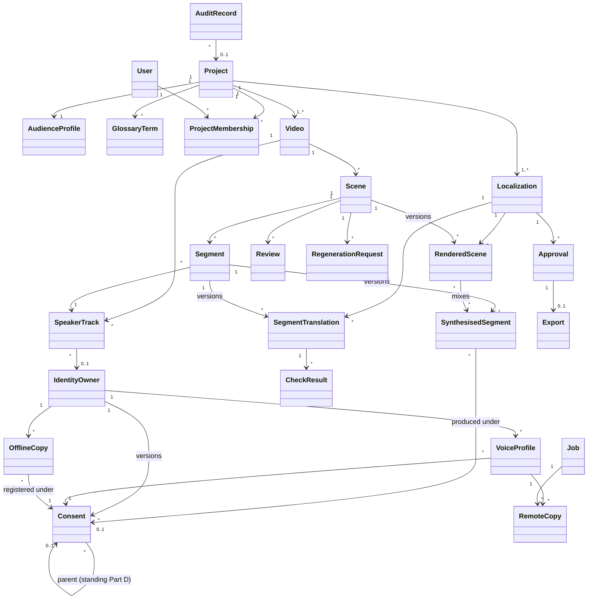

# ADR 0014: Core data model (UML-ready)

**Status:** Accepted (approved by the user 2026-10-05). History: proposed 2026-10-05; revised the same day after independent review. **Amended 2026-10-06 by ADR 0020** (Project.purpose, standing and derived Consent, IdentityOwner withdrawal fields, Export `PURGED`, `OfflineCopy`, invariants 6 and 8).
**Source:** `docs/PHASE0_DISCOVERY.md` §7; ADRs 0003, 0005–0008, 0011, 0013

## Context

The core entities are listed in CLAUDE.md §9 (Project, Video, Scene, Localization, Consent, Review, Approval, Export, AuditRecord). There is no UML yet (Q1); class diagrams will be drawn **from** this model, so names, relationships and multiplicities must be explicit. The MVP uses one language pair, English → Tamil (Q3), and **one target locale per project** (Q14, confirmed 2026-10-05).

## Options Considered

| Criterion | Mutable rows (update in place) | **Versioned rows for drafts, renders and consent; immutable approval snapshot** | Full event sourcing |
|---|---|---|---|
| History and evidence | Lost on edit | **Kept** | Complete |
| Approval integrity | Hard to guarantee | **Snapshot of exact versions** | Yes |
| Complexity for the team | Low | **Medium** | High |
| Viva | Weak on evidence | **Clear** | Hard to explain |

## Decision

| Entity | Key fields | Rules |
|---|---|---|
| **Project** | name, source_language (`en`), domain, status, **data_classification** (`SCRIPTED_TEAM` / `PERSONAL`), **allow_external_audio** (default false), created_by, **purpose** (`STANDARD` / `DEMO_REHEARSAL`) *(amended by ADR 0020, 2026-10-06)* | `data_classification` decides whether the Gemini free tier may receive text (ADR 0005); `allow_external_audio` is used by CP0 (ADR 0006); `DEMO_REHEARSAL` is set only by `demo_reset` (ADR 0020) |
| AudienceProfile | locale (`ta-IN`), formality, reading_level, unit_conversions, cultural_notes | Context input (ADR 0016) |
| GlossaryTerm | source_term, target_term, accepted_forms[], do_not_translate, note | Hard checks (ADR 0008) |
| ProjectMembership | user, project, role | ADR 0011 |
| **Video** | storage_key, sha256, duration, container, codecs, size, status | ffprobe-validated (ADR 0004) |
| SpeakerTrack | video, label, identity_owner (nullable), assigned_by | Human-corrected |
| **Scene** | video, index, start_ms, end_ms, **status** | States: `PENDING → TRANSLATED → IN_REVIEW → CHANGES_REQUESTED → REGENERATING → IN_REVIEW → ACCEPTED`; any state → `NEEDS_REGENERATION` (consent revoked or upstream edit) |
| Segment | scene, speaker_track, start_ms, end_ms, source_text, asr_confidence | Unit of translation |
| **Localization** | project, target_locale, status | One per project in the MVP |
| SegmentTranslation | segment, localization, **version**, subtitle_text, speech_text, adaptation_type, rationale, origin (AI/HUMAN), adapter, model, prompt_version, is_fallback | Append-only versions |
| CheckResult | segment_translation, kind (HARD / AI_FLAG), check_type, status (PASS / FAIL / UNVERIFIABLE / FLAGGED / CHECK_UNAVAILABLE), detail, resolution (FIXED / OVERRIDDEN / ACKNOWLEDGED), resolved_by, reason | Unresolved results block approval |
| **SynthesisedSegment** *(added after review)* | segment, localization, **version**, audio_key, sha256, rendering_mode, consent (nullable), consent_version, adapter, model, runtime (LOCAL / KAGGLE), is_fallback, is_mock, status (ACTIVE / QUARANTINED / PURGED) | Saved at CP5 under the IdentityOwner lock |
| RenderedScene | scene, localization, **version**, audio_key, video_key, synthesised_segments (M2M), consent_versions, is_mock, status (ACTIVE / QUARANTINED / PURGED) | Saved at CP7 |
| IdentityOwner | name, user (nullable), withdrawn_at, withdrawn_by, withdrawal_evidence *(amended by ADR 0020, 2026-10-06)* | **The lock row for consent** (ADR 0006 §4). Several owners are locked in ascending id order. Withdrawal is final. |
| **Consent** | identity_owner, **version**, uses[] (`voice_synthesis`, `remote_voice_processing`, `external_transcription`), project, languages[], expires_at, processors[], status (ACTIVE / REVOKED / EXPIRED), evidence_key, granted_by, revoked_at, revoked_by; **kind** (`PROJECT` / `STANDING_PART_D`), **parent_consent** (required for `PROJECT`), **part_d_uses[]** (standing only) *(amended by ADR 0020, 2026-10-06)* | A new row for every change. "Current" = the latest version for the owner and scope. `project` is null only for `STANDING_PART_D`, which the gate never accepts directly. |
| **VoiceProfile** *(corrected after review)* | identity_owner, consent, storage_key (reference clip), transcript, language (`en` / `ta`), sha256, duration_ms, status (ACTIVE / DELETED), deleted_at | Our own stored clip; no provider-side clone |
| **RemoteCopy** *(added after review)* | voice_profile, job, kind (DATASET / KERNEL), slug, created_at, deleted_at, status (PRESENT / DELETION_PENDING / DELETED) | Every Kaggle copy is recorded, so purge can find it after a crash |
| **OfflineCopy** *(amended by ADR 0020, 2026-10-06)* | identity_owner, consent_version, kind (`DEMO_SEED_REFERENCE` / `DEMO_SEED_CLONED_AUDIO` / `SCREEN_RECORDING`), storage_key (under `media/offline/`), sha256, created_at, deleted_at, status (PRESENT / DELETION_PENDING / DELETED) | Every identity file outside the normal artefact tables is registered, so narrowing, withdrawal and expiry can purge it (ADR 0020 §4) |
| **Review** | scene, localization, reviewer, decision (ACCEPT / CHANGES_REQUESTED), issues (MQM category, severity), comment, reviewed_versions | |
| RegenerationRequest | scene, requested_by, reason, instruction, job | |
| **Approval** | localization, approver, approved_at, snapshot (exact SegmentTranslation, SynthesisedSegment and RenderedScene versions), status (VALID / INVALIDATED), invalidated_reason | Immutable once VALID |
| **Export** | approval, package_key, manifest (JSON), manifest_sha256, status (ACTIVE / CONSENT_REVOKED / PURGED *(amended by ADR 0020, 2026-10-06)*) | Only from a VALID approval; **refused if any artefact has is_mock** |
| **Job** *(expanded after review)* | type, lane, status (QUEUED / RUNNING / DISPATCHED / SUCCEEDED / FAILED / CANCELLED), cancel_requested (flag), cancel_reason, attempts, run_after, heartbeat_at, dispatched_at, remote_ref, error, consent_versions; targets (all nullable): video, scene, localization, identity_owner | ADR 0003 |
| **AuditRecord** / AuditChainHead | seq, actor, action, entity, project, scene, consent_version, timestamp, details, prev_hash, hash | ADR 0007 |
| ProviderConfig, ProviderUsage, Policy | provider chain order per stage; free-quota usage units per call; quota warnings, retention, cloning allowed, separation of duties | ADR 0005, UC8 |

**Invariants (each becomes a test):**
1. Every `CLONED_VOICE` SynthesisedSegment and RenderedScene references the Consent version it was produced under, and that version was the latest and ACTIVE when it was saved (checked under the IdentityOwner lock).
2. An Export references a VALID Approval; every consent version in it was the latest and ACTIVE at export time; no artefact in it has `is_mock`.
3. Any new SegmentTranslation, SynthesisedSegment or RenderedScene version for an approved Localization invalidates its Approval.
4. Translations, renders, consents and audit records are never updated in place (only status fields that are explicitly defined change).
5. Approval is impossible while any HARD CheckResult is FAIL or UNVERIFIABLE without a resolution, or any AI_FLAG or CHECK_UNAVAILABLE result is unacknowledged.
6. Every audited action (ADR 0007: consent, approval, regeneration, export, job state changes; not heartbeats or polls) writes **at least one** AuditRecord in the same transaction *(amended by ADR 0020, 2026-10-06)*.
7. Every Kaggle upload has a RemoteCopy row **before** the upload starts, so nothing remote is ever untracked.
8. *(amended by ADR 0020, 2026-10-06)* Every file in `media/offline/` has an `OfflineCopy` row, and every `PROJECT` Consent version has a parent standing version and is no wider than it (uses, languages, processors, `expires_at`).

## Consequences

- **+** The class diagram, state diagrams and evidence manifest all come from one model.
- **−** Versioning adds rows and requires "latest version" queries, which need small, tested helper functions.
- **−** One locale per project is a scope limit, not a model limit (Localization is already 1..*).
- **Viva in 2 minutes:** "Drafts, renders and consent are versioned, never overwritten. Approval freezes the exact versions. Every artefact records the consent version it was made under, which is what lets revocation find everything it affects."
