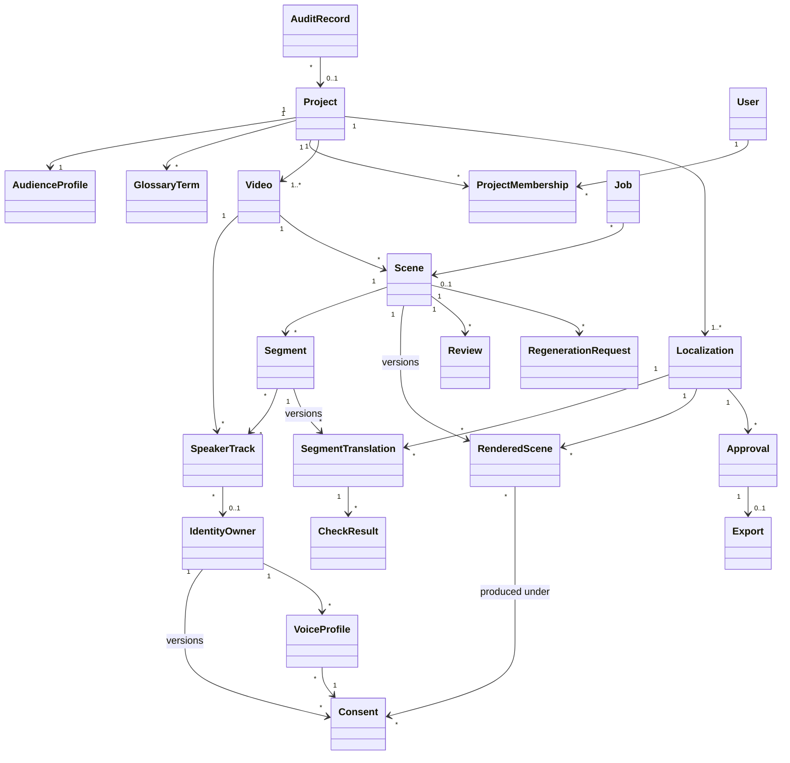

# ADR 0014: Core data model (UML-ready)

**Status:** Proposed (2026-10-05). Not yet approved.
**Source:** `docs/PHASE0_DISCOVERY.md` §7; ADRs 0003, 0005–0008, 0011, 0013

## Context

The core entities are listed in CLAUDE.md §9 (Project, Video, Scene, Localization, Consent, Review, Approval, Export, AuditRecord). There is no UML yet (Q1); class diagrams will be drawn **from** this model, so names, relationships and multiplicities must be explicit. The MVP uses one language pair, English → Tamil (Q3), and **one target locale per project** (Q14, proposed default).

## Options Considered

| Criterion | Mutable rows (update in place) | **Versioned rows for drafts, renders and consent; immutable approval snapshot** | Full event sourcing |
|---|---|---|---|
| History and evidence | Lost on edit | **Kept** | Complete |
| Approval integrity | Hard to guarantee | **Snapshot of exact versions** | Yes |
| Complexity for the team | Low | **Medium** | High |
| Viva | Weak on evidence | **Clear** | Hard to explain |

## Decision

| Entity | Key fields | Rules |
|---|---|---|
| **Project** | name, source_language (`en`), domain, status, created_by | |
| AudienceProfile | locale (`ta-IN`), formality, reading_level, unit_conversions, cultural_notes | Context input (ADR 0016) |
| GlossaryTerm | source_term, target_term, **accepted_forms[]**, do_not_translate, note | Used by the hard checks (ADR 0008) |
| ProjectMembership | user, project, role | ADR 0011 |
| **Video** | storage_key, sha256, duration, container, codecs, size, status | Validated with ffprobe (ADR 0004) |
| SpeakerTrack | video, label, identity_owner (nullable), assigned_by | Human-corrected |
| **Scene** | video, index, start_ms, end_ms, status | Unit of rendering, review and regeneration |
| Segment | scene, speaker_track, start_ms, end_ms, source_text, asr_confidence | Unit of translation |
| **Localization** | project, target_locale, status | One per project in the MVP |
| SegmentTranslation | segment, localization, **version**, subtitle_text, speech_text, adaptation_type, rationale, origin (AI/HUMAN), provider, model, prompt_version | **Append-only versions** |
| CheckResult | segment_translation, kind (HARD / AI_FLAG), check_type, status (PASS / FAIL / UNVERIFIABLE / FLAGGED), detail, resolution (FIXED / OVERRIDDEN / ACKNOWLEDGED), resolved_by, reason | Unresolved HARD failures block approval |
| RenderedScene | scene, localization, **version**, audio_key, video_key, rendering_modes, consent_versions (M2M), status (ACTIVE / QUARANTINED) | ADR 0006 |
| IdentityOwner | name, user (nullable) | |
| **Consent** | identity_owner, **version**, uses[], project, languages[], expires_at, processors[], status (ACTIVE / REVOKED / EXPIRED), evidence_key, granted_by, revoked_at, revoked_by | **A new row for every change** |
| VoiceProfile | identity_owner, consent, provider, provider_voice_id, status (ACTIVE / DELETION_PENDING / DELETED), deletion_confirmed_at | ADR 0005 / 0006 |
| **Review** | scene, localization, reviewer, decision (ACCEPT / CHANGES_REQUESTED), issues (MQM category, severity), comment, reviewed_versions | |
| RegenerationRequest | scene, requested_by, reason, instruction, job | |
| **Approval** | localization, approver, approved_at, **snapshot** (exact SegmentTranslation and RenderedScene versions), status (VALID / INVALIDATED), invalidated_reason | Immutable once VALID |
| **Export** | approval, package_key, manifest (JSON), manifest_sha256, status (ACTIVE / CONSENT_REVOKED) | Only from a VALID approval |
| Job | type, scene/video, status, attempts, run_after, heartbeat_at, cancel_requested, error, consent_versions | ADR 0003 |
| **AuditRecord** / AuditChainHead | seq, actor, action, entity, project, scene, consent_version, timestamp, details, prev_hash, hash | ADR 0007 |
| ProviderConfig, ProviderUsage, Policy | provider settings; free-quota usage units per call; provider chain order, quota warnings, retention, cloning allowed, separation of duties | ADR 0005, UC8 |

**Invariants (each becomes a test):**
1. Every `CLONED_VOICE` RenderedScene references the Consent versions it was produced under, and they were ACTIVE when it was saved.
2. An Export references a VALID Approval, and every consent version in it was ACTIVE at export time.
3. Any new SegmentTranslation or RenderedScene version for an approved Localization invalidates its Approval.
4. Translations, renders, consents and audit records are never updated in place (only status fields that are explicitly defined change).
5. Approval is impossible while any HARD CheckResult is FAIL or UNVERIFIABLE without a resolution, or any AI_FLAG is unacknowledged.
6. Every state change writes exactly one AuditRecord in the same transaction.

## Consequences

- **+** The class diagram, state diagrams and evidence manifest all come from one model.
- **−** Versioning adds rows and requires "latest version" queries, which need small, tested helper functions.
- **−** One locale per project is a scope limit, not a model limit (Localization is already 1..*).
- **Viva in 2 minutes:** "Drafts, renders and consent are versioned, never overwritten. Approval freezes the exact versions. Every artefact records the consent version it was made under, which is what lets revocation find everything it affects."
