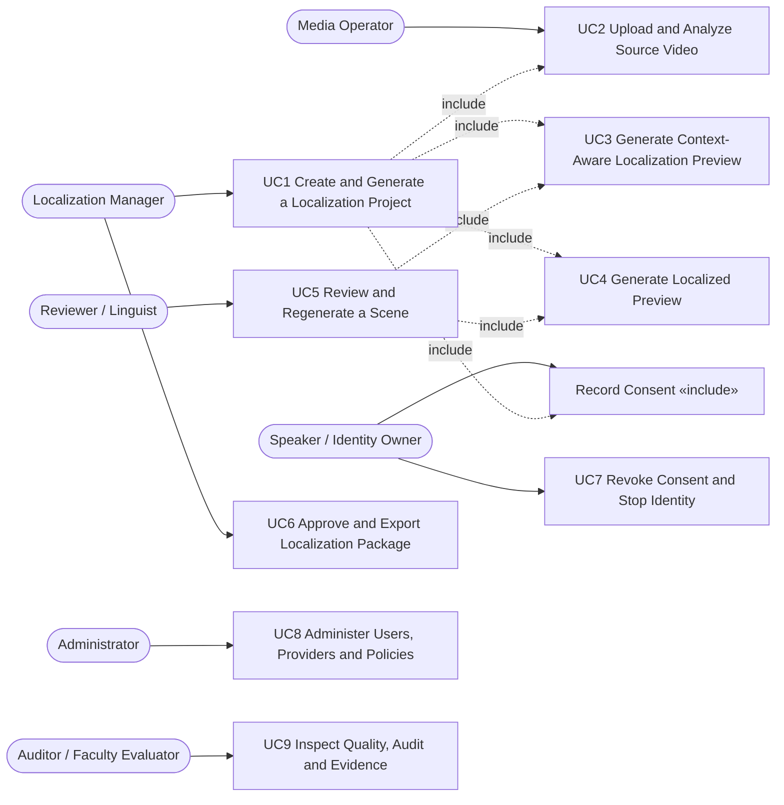
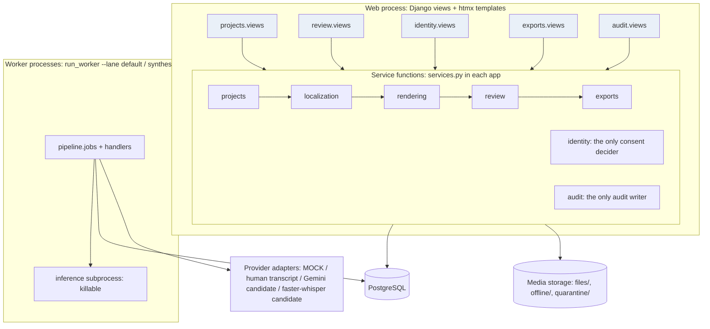
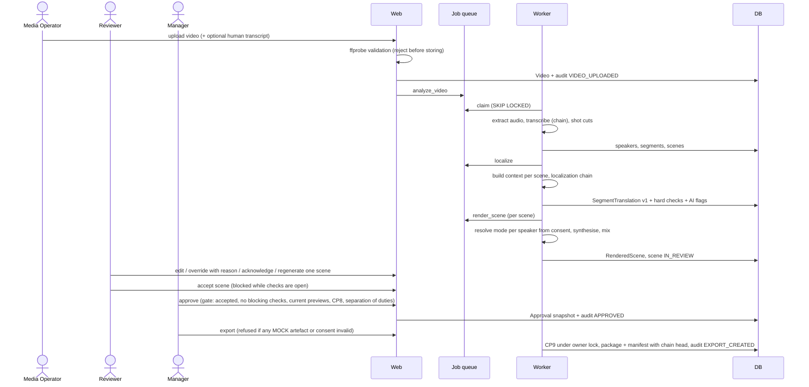
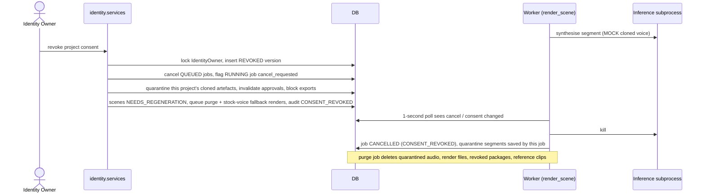
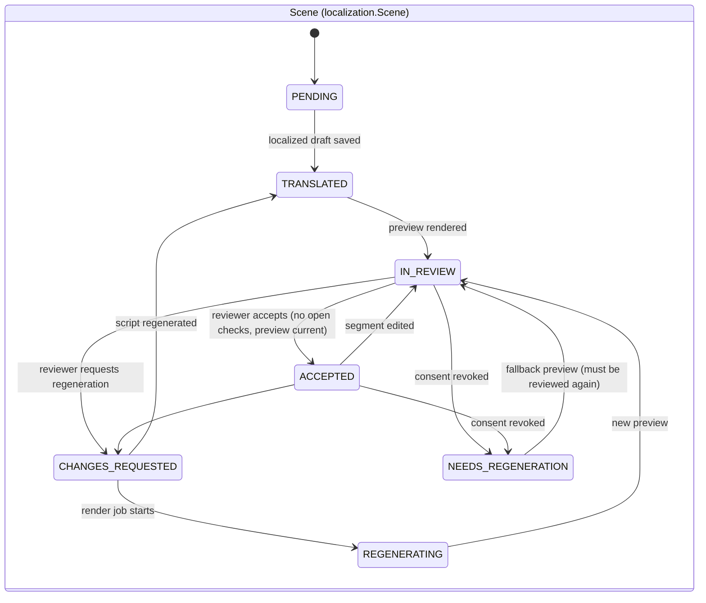
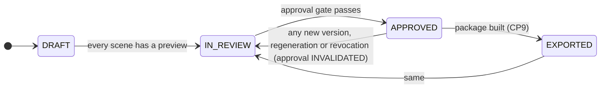
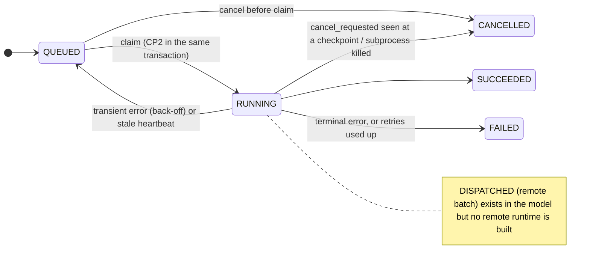
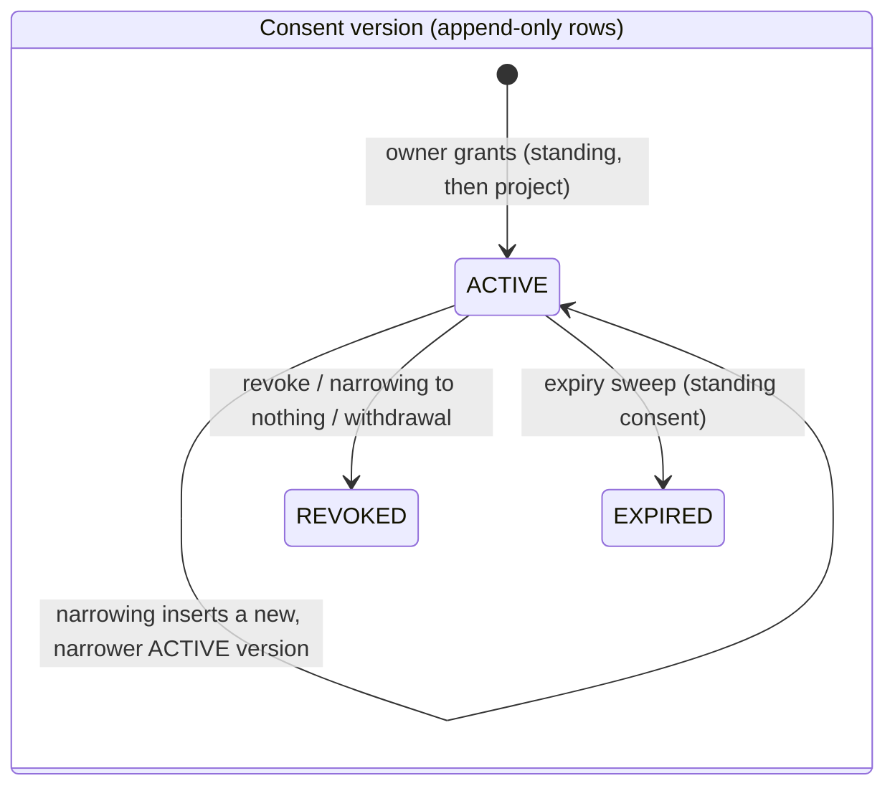

# UML diagrams

| Diagram | Source | Kind |
|---|---|---|
| Class diagram | [`class_diagram.md`](class_diagram.md) | **Generated from the Django models** by `scripts/generate_uml.py` (actual classes only) |
| Use cases, components, sequences, states | this file | Hand-drawn **from the implemented code**; each names the module it describes |

Labels: the **conceptual workflow** (product) is drawn as the use-case diagram. The **actual components** are the Django apps. The **actual classes** are in the generated class diagram.

## 1. Use cases (conceptual workflow; actors and UC1–UC9 are [CONFIRMED])

## 2. Components (actual Django apps, ADR 0001)

## 3. Sequence: the main workflow (as implemented)

## 4. Sequence: revocation while a cloned-voice job runs (tested: `test_running_job_is_stopped_within_seconds`)

## 5. State machines (as implemented)

## What these diagrams do NOT show (not implemented)

Visual context, remote GPU runtimes (Kaggle), external ASR (CP0), real TTS and voice models, and C2PA manifests.
