# UML class diagram (generated from the code)

Generated by `scripts/generate_uml.py` from the actual Django models. Do not edit by hand: rerun the script.
Relationship labels are the foreign-key field names; multiplicities come from `null` on the field.

```mermaid
classDiagram
  direction LR
  namespace accounts {
    class User {
      +id id
      +Char username
      +Boolean is_active
      +Boolean is_administrator
    }
    class ProjectMembership {
      +id id
      +Char role
    }
    class Policy {
      +id id
      +Char key
      +json value
      +DateTime updated_at
    }
  }
  namespace projects {
    class Project {
      +id id
      +Char name
      +Char source_language
      +Char domain
      +Char status
      +Char data_classification
      +Boolean allow_external_audio
      +Char purpose
      +DateTime created_at
    }
    class AudienceProfile {
      +id id
      +Char locale
      +Char formality
      +Char reading_level
      +json unit_conversions
      +Text cultural_notes
    }
    class GlossaryTerm {
      +id id
      +Char source_term
      +Char target_term
      +json accepted_forms
      +Boolean do_not_translate
      +Char note
    }
    class Video {
      +id id
      +Char original_name
      +Char storage_key
      +Char audio_key
      +Char transcript_key
      +Char sha256
      +Integer duration_ms
      +Char container
      +json codecs
      +BigInteger size
      +Boolean has_video_stream
      +Char status
      +Char transcript_adapter
      +Char transcript_model
      +Boolean transcript_is_mock
      +Text error
      +DateTime created_at
    }
    class SpeakerTrack {
      +id id
      +Char label
    }
  }
  namespace localization {
    class Localization {
      +id id
      +Char target_locale
      +Char status
    }
    class Scene {
      +id id
      +Integer index
      +Integer start_ms
      +Integer end_ms
      +Char status
    }
    class Segment {
      +id id
      +Integer index
      +Integer start_ms
      +Integer end_ms
      +Text source_text
      +Decimal asr_confidence
    }
    class SegmentTranslation {
      +id id
      +Integer version
      +Text subtitle_text
      +Text speech_text
      +Char adaptation_type
      +Text rationale
      +json uncertainty_flags
      +Char origin
      +Char adapter
      +Char model
      +Char prompt_version
      +Boolean is_fallback
      +Boolean is_mock
      +json context_inputs
      +DateTime created_at
    }
    class CheckResult {
      +id id
      +Char kind
      +Char check_type
      +Char status
      +json detail
      +Char resolution
      +Text reason
      +DateTime resolved_at
    }
  }
  namespace rendering {
    class SynthesisedSegment {
      +id id
      +Integer version
      +Char audio_key
      +Char sha256
      +Integer duration_ms
      +Char rendering_mode
      +Integer consent_version
      +Char adapter
      +Char model
      +Char runtime
      +Decimal tempo
      +Boolean is_fallback
      +Boolean is_mock
      +Char status
      +DateTime created_at
    }
    class RenderedScene {
      +id id
      +Integer version
      +Char audio_key
      +Char video_key
      +Text subtitles_vtt
      +json translation_ids
      +json consent_versions
      +json rendering_modes
      +Boolean is_mock
      +Char status
      +DateTime created_at
    }
  }
  namespace review {
    class Review {
      +id id
      +Char decision
      +json issues
      +Text comment
      +json reviewed_versions
      +DateTime created_at
    }
    class RegenerationRequest {
      +id id
      +Char target
      +Char reason
      +Text instruction
      +DateTime created_at
    }
    class Approval {
      +id id
      +DateTime approved_at
      +json snapshot
      +Char status
      +Char invalidated_reason
    }
  }
  namespace identity {
    class IdentityOwner {
      +id id
      +Char name
      +DateTime withdrawn_at
      +Char withdrawal_evidence
    }
    class Consent {
      +id id
      +Char kind
      +Integer version
      +json uses
      +json permitted_purposes
      +json permitted_copy_kinds
      +json languages
      +json processors
      +DateTime expires_at
      +Char status
      +Char evidence_ref
      +Char grant_reason
      +DateTime revoked_at
      +DateTime created_at
    }
    class VoiceProfile {
      +id id
      +Char storage_key
      +Text transcript
      +Char language
      +Char sha256
      +Integer duration_ms
      +Char status
      +DateTime deleted_at
    }
    class OfflineCopy {
      +id id
      +Char kind
      +Char storage_key
      +Char language
      +Char sha256
      +DateTime created_at
      +DateTime deleted_at
      +Char status
    }
  }
  namespace exports {
    class Export {
      +id id
      +Char package_key
      +Char package_sha256
      +json manifest
      +Char manifest_sha256
      +Char status
      +Text error
      +DateTime created_at
    }
  }
  namespace audit {
    class AuditChainHead {
      +id id
      +BigInteger seq
      +Char hash
    }
    class AuditRecord {
      +id id
      +BigInteger seq
      +Char actor_label
      +Char action
      +Char entity_type
      +Char entity_id
      +BigInteger project_id
      +BigInteger scene_id
      +Char consent_version
      +DateTime timestamp
      +json details
      +Char prev_hash
      +Char hash
    }
  }
  namespace pipeline {
    class Job {
      +id id
      +Char type
      +Char lane
      +Char status
      +Boolean cancel_requested
      +Char cancel_reason
      +Integer attempts
      +Integer max_attempts
      +DateTime run_after
      +DateTime heartbeat_at
      +DateTime dispatched_at
      +Char remote_ref
      +Text error
      +json consent_versions
      +json payload
      +Char progress
      +DateTime created_at
      +DateTime started_at
      +DateTime finished_at
    }
    class ProviderConfig {
      +id id
      +Char stage
      +json adapters
      +DateTime updated_at
    }
    class ProviderUsage {
      +id id
      +Char adapter
      +Char stage
      +Integer units
      +Char unit_type
      +DateTime created_at
    }
  }
  ProjectMembership "*" --> "1" User : user
  ProjectMembership "*" --> "1" Project : project
  Project "*" --> "1" User : created_by
  AudienceProfile "0..1" --> "1" Project : project
  GlossaryTerm "*" --> "1" Project : project
  Video "*" --> "1" Project : project
  Video "*" --> "1" User : uploaded_by
  SpeakerTrack "*" --> "1" Video : video
  SpeakerTrack "*" --> "0..1" IdentityOwner : identity_owner
  SpeakerTrack "*" --> "0..1" User : assigned_by
  Localization "*" --> "1" Project : project
  Scene "*" --> "1" Video : video
  Segment "*" --> "1" Scene : scene
  Segment "*" --> "0..1" SpeakerTrack : speaker_track
  SegmentTranslation "*" --> "1" Segment : segment
  SegmentTranslation "*" --> "1" Localization : localization
  SegmentTranslation "*" --> "0..1" User : created_by
  CheckResult "*" --> "1" SegmentTranslation : segment_translation
  CheckResult "*" --> "0..1" User : resolved_by
  SynthesisedSegment "*" --> "1" Segment : segment
  SynthesisedSegment "*" --> "1" Localization : localization
  SynthesisedSegment "*" --> "1" SegmentTranslation : translation
  SynthesisedSegment "*" --> "0..1" Consent : consent
  RenderedScene "*" --> "1" Scene : scene
  RenderedScene "*" --> "1" Localization : localization
  RenderedScene "*" --> "*" SynthesisedSegment : synthesised_segments
  Review "*" --> "1" Scene : scene
  Review "*" --> "1" Localization : localization
  Review "*" --> "1" User : reviewer
  RegenerationRequest "*" --> "1" Scene : scene
  RegenerationRequest "*" --> "1" User : requested_by
  RegenerationRequest "*" --> "0..1" Job : job
  Approval "*" --> "1" Localization : localization
  Approval "*" --> "1" User : approver
  IdentityOwner "0..1" --> "0..1" User : user
  IdentityOwner "*" --> "0..1" User : withdrawn_by
  Consent "*" --> "1" IdentityOwner : identity_owner
  Consent "*" --> "0..1" Consent : parent_consent
  Consent "*" --> "0..1" Project : project
  Consent "*" --> "0..1" User : granted_by
  Consent "*" --> "0..1" User : revoked_by
  VoiceProfile "*" --> "1" IdentityOwner : identity_owner
  VoiceProfile "*" --> "1" Consent : consent
  OfflineCopy "*" --> "1" IdentityOwner : identity_owner
  OfflineCopy "*" --> "1" Consent : consent_version
  Export "*" --> "1" Approval : approval
  AuditRecord "*" --> "0..1" User : actor
  Job "*" --> "0..1" Project : project
  Job "*" --> "0..1" Video : video
  Job "*" --> "0..1" Scene : scene
  Job "*" --> "0..1" Localization : localization
  Job "*" --> "0..1" IdentityOwner : identity_owner
  ProviderUsage "*" --> "0..1" Project : project
```

